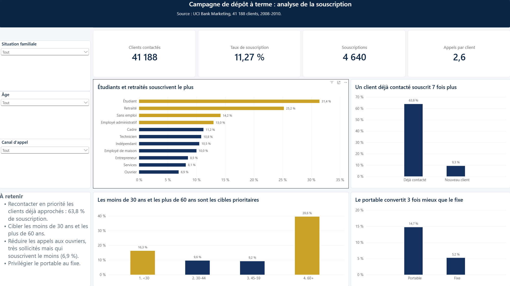
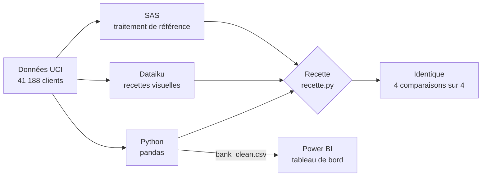
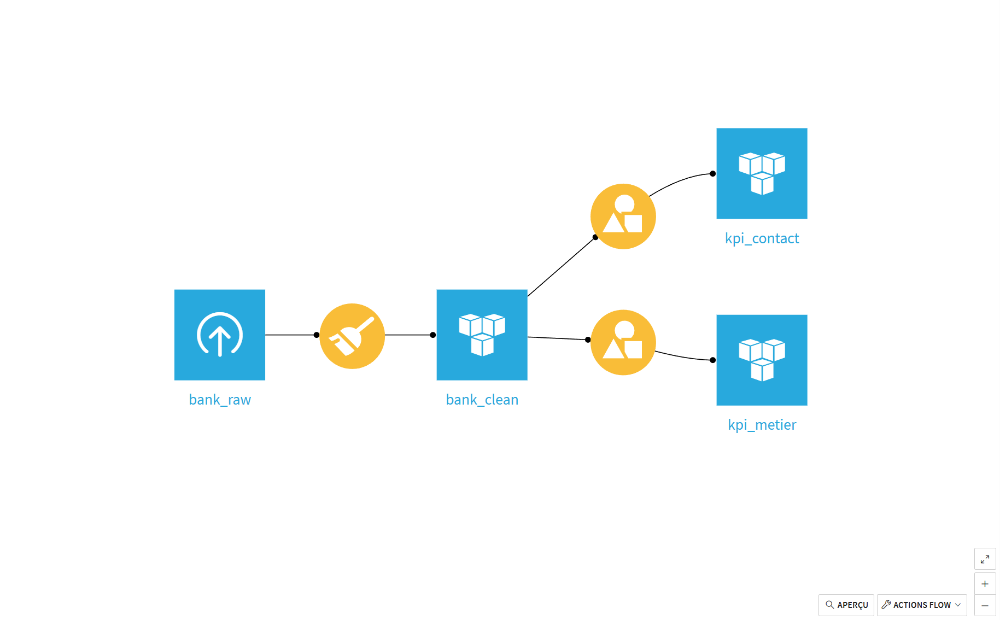
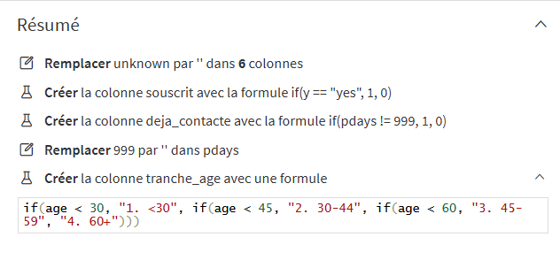

# Migration d'un traitement SAS vers Dataiku et Python

Un traitement de données bancaires migré de SAS vers Dataiku puis Python, avec une recette de non-régression qui prouve que les trois versions donnent exactement les mêmes chiffres.


Projet réalisé par **Alexis Claudeon**, Data Analyst · [LinkedIn](https://www.linkedin.com/in/alexis-claudeon) · [Contact](#contact)



## En bref

- **Contexte :** les banques migrent leurs traitements SAS vers Dataiku et Python (coût des licences, rareté des profils SAS, passage au cloud). Le risque : qu'un chiffre change pendant la migration sans que personne ne s'en aperçoive.
- **Ce que j'ai fait :** j'ai écrit le même traitement dans les trois outils (nettoyage de 41 188 clients, deux indicateurs), puis un script Python qui compare les résultats.
- **Résultat :** Dataiku et Python reproduisent SAS à l'identique, et six pièges de migration ont été identifiés et résolus en chemin.
- **Apport métier :** un tableau de bord Power BI et quatre recommandations pour mieux cibler la campagne.

## Résultats clés

Sur **41 188 clients** appelés, **4 640** ont souscrit un dépôt à terme, soit un taux de **11,27 %**.

| Constat | Chiffres |
|---|---|
| Un client déjà contacté lors d'une campagne précédente souscrit environ **7 fois plus** | 63,8 % (1 515 clients) contre 9,3 % (39 673 clients) |
| Les **moins de 30 ans** et les **60 ans et plus** répondent le mieux | 16,3 % et 39,6 %, contre 9 à 10 % entre 30 et 59 ans |
| Les **étudiants** et les **retraités** souscrivent le plus | 31,4 % et 25,2 % |
| Les **ouvriers** sont très sollicités mais souscrivent le moins | 6,9 %, alors qu'ils forment le 2e groupe le plus appelé (9 254 clients) |
| Le **portable** convertit près de 3 fois mieux que le fixe | 14,7 % contre 5,2 % |

### Recommandations

1. **Recontacter en priorité les clients déjà approchés** (63,8 % de souscription).
2. **Cibler les moins de 30 ans et les plus de 60 ans**, nettement au-dessus de la moyenne de 11,27 %.
3. **Réduire les appels aux ouvriers**, deuxième population la plus appelée pour le taux le plus faible.
4. **Privilégier le portable** au fixe.

Ces recommandations sont à lire avec les [limites](#limites) de l'analyse.

## Démarche



1. **SAS, la référence** : import, nettoyage et calcul des indicateurs ([`sas/01_traitement_sas.sas`](sas/01_traitement_sas.sas)).
2. **Dataiku, la migration visuelle** : le même traitement reconstruit en recettes Préparer et Grouper.
3. **Python, la migration en code** : traduction en pandas ([`python/traitement.py`](python/traitement.py)), puis recette de non-régression qui compare les trois versions ([`python/recette.py`](python/recette.py)).
4. **Power BI, la restitution** : tableau de bord avec filtres par situation familiale, âge et canal d'appel.

<p align="center">
  
  
</p>
<p align="center"><em>Le Flow Dataiku et les cinq étapes de la recette Préparer</em></p>

## Recette : la preuve que les chiffres n'ont pas changé

[`python/recette.py`](python/recette.py) compare les indicateurs de Dataiku et de Python à ceux de SAS, pris comme référence :

- l'ordre des colonnes et des lignes est harmonisé, car chaque outil exporte dans un ordre différent ;
- les tables sont comparées valeur par valeur (`pandas.testing.assert_frame_equal`), avec une tolérance relative de 1e-6, car SAS arrondit à 10 décimales à l'export ;
- le script affiche `identique`, ou `ÉCART` avec le détail de la différence.

```
===== Taux par métier =====
Dataiku vs SAS : identique
Python vs SAS : identique

===== Effet d'un contact précédent =====
Dataiku vs SAS : identique
Python vs SAS : identique
```

**La recette sait aussi détecter une erreur.** Lancée sur le premier export SAS, mal formaté (piège 4 ci-dessous, fichier conservé dans `outputs/archive/`), elle signale bien un `ÉCART` (`13.0% != 0.1297…`).

## Pièges rencontrés et solutions

| # | Outil | Problème | Solution |
|---|---|---|---|
| 1 | Dataiku | L'analyse porte par défaut sur les 10 000 premières lignes. Le fichier étant trié par date, Dataiku affichait 100 % de `pdays = 999` au lieu de 96,3 %. | Passer l'échantillon en mode aléatoire ou sur le jeu complet avant toute conclusion. |
| 2 | Dataiku | Dans la recette Grouper, « Nombre » compte les lignes non vides : il donnait le nombre de clients, pas le nombre de souscriptions. | Utiliser « Somme », qui additionne les 1 de la colonne `souscrit`. |
| 3 | Dataiku | Le pré-filtre réglé sur « N'est pas défini » ne gardait qu'une ligne (les 330 clients au métier inconnu) au lieu des 11 métiers. | Inverser la condition en « Est défini ». |
| 4 | SAS | `proc export` écrit les valeurs formatées : le taux sortait en texte (`31.4%`) et 2,104 appels étaient arrondis à 2,1. | Retirer les formats dans une étape DATA juste avant l'export. |
| 5 | SAS | Après l'expiration de la session, une étape DATA en erreur a créé une table vide, exportée sans alerte. | Problème détecté par [`python/diagnostic.py`](python/diagnostic.py) ; contrôler le journal et le contenu de chaque export. |
| 6 | Power BI | En paramètres régionaux français, la valeur `1.1` de `emp.var.rate` a été lue comme une date. | Forcer les types dans le code M avec la culture du fichier : `Table.TransformColumnTypes(..., "en-US")`. |

## Limites

- **Corrélation n'est pas causalité.** Les clients déjà contactés ont pu être rappelés justement parce qu'ils étaient intéressés. Seule une campagne test avec un groupe témoin mesurerait l'effet réel du recontact.
- **Petit effectif des étudiants.** Leur taux de 31,4 % repose sur 875 clients seulement ; il doit être confirmé sur d'autres campagnes.
- **La durée d'appel (`duration`) est à exclure de tout modèle prédictif.** Elle n'est connue qu'une fois l'appel terminé : l'utiliser pour prédire la souscription serait une fuite de données.
- **Qualité de la colonne `default`.** Elle ne compte que 3 « yes » et environ 21 % de valeurs inconnues, ce qui la rend peu exploitable.

## Outils et compétences

| Outil | Utilisé pour |
|---|---|
| SAS OnDemand for Academics | traitement de référence : `proc import`, étape DATA, `proc sql`, `proc export` |
| Dataiku Cloud | Flow visuel : recette Préparer, recettes Grouper avec pré-filtre |
| Python 3.14, pandas 3.0.5 | traitement en code, recette de non-régression, scripts de contrôle |
| Power BI Desktop | tableau de bord avec filtres, mesures DAX, Power Query (code M), thème personnalisé |
| Git, GitHub | versionnement du projet |

Compétences transverses : qualité des données, tests de non-régression, analyse de la conversion, recommandations métier.

## Données

- **Source :** [UCI Machine Learning Repository, Bank Marketing](https://archive.ics.uci.edu/dataset/222/bank+marketing), fichier `bank-additional-full.csv`.
- **Contenu :** campagnes de télémarketing d'une banque portugaise pour un dépôt à terme, 2008-2010, 41 188 clients et 21 variables.
- **Licence :** [CC BY 4.0](https://creativecommons.org/licenses/by/4.0/), qui autorise la redistribution du fichier dans ce dépôt avec citation des auteurs.
- **Référence :** Moro, S., Cortez, P. et Rita, P. (2014). A data-driven approach to predict the success of bank telemarketing. *Decision Support Systems*, 62, 22-31. https://doi.org/10.1016/j.dss.2014.03.001

## Détails techniques

<details>
<summary><strong>Règles de traitement dans les trois outils</strong></summary>

<br>

Les cinq règles sont appliquées dans le même ordre dans les trois outils.

| # | Règle | SAS | Dataiku (recette Préparer) | Python (pandas) |
|---|---|---|---|---|
| 1 | `unknown` devient une valeur manquante sur `job`, `marital`, `education`, `default`, `housing`, `loan` | tableau `array txt{*}` parcouru par une boucle : `if txt{i} = "unknown" then txt{i} = "";` | Remplacer `unknown` par `''` dans 6 colonnes | `clean[colonnes_texte].replace("unknown", pd.NA)` |
| 2 | `souscrit` vaut 1 si `y = "yes"`, sinon 0 | `souscrit = (y = "yes");` | Formule `if(y == "yes", 1, 0)` | `(clean["y"] == "yes").astype(int)` |
| 3 | `deja_contacte` vaut 1 si `pdays` est différent de 999, calculé avant la règle 4 | `deja_contacte = (pdays ne 999);` | Formule `if(pdays != 999, 1, 0)` | `(clean["pdays"] != 999).astype(int)` |
| 4 | `pdays = 999` devient une valeur manquante | `if pdays = 999 then pdays = .;` | Remplacer `999` par `''` dans `pdays` | `clean["pdays"].mask(clean["pdays"] == 999)` |
| 5 | `tranche_age` : `1. <30`, `2. 30-44`, `3. 45-59`, `4. 60+` | `if age < 30 then ...; else if age < 45 then ...;` | Formule `if(age < 30, "1. <30", if(age < 45, ...))` | `pd.cut(age, bins=[0, 30, 45, 60, 200], right=False, labels=[...])` |

L'ordre des règles 3 et 4 est imposé : une fois 999 remplacé par une valeur manquante, l'information « jamais contacté » ne pourrait plus être calculée. Les préfixes numérotés de `tranche_age` garantissent un tri correct dans tous les outils ; sans eux, `<30` serait classé après `60+`.

| Indicateur | Contenu | SAS | Dataiku | Python |
|---|---|---|---|---|
| `kpi_metier` | par métier, métiers inconnus exclus : `nb_clients`, `nb_souscriptions`, `taux_souscription`, `nb_appels_moyen` | `proc sql` avec `where job ne ""` et `group by job` | recette Grouper sur `job`, pré-filtre « `job` est défini » | `dropna(subset=["job"]).groupby("job").agg(...)` |
| `kpi_contact` | par `deja_contacte` : `nb_clients`, `taux_souscription` | `proc sql` avec `group by deja_contacte` | recette Grouper sur `deja_contacte` | `groupby("deja_contacte").agg(...)` |

Le taux de souscription est la moyenne de `souscrit`, et le nombre d'appels moyen la moyenne de `campaign`.

</details>

<details>
<summary><strong>Mesures DAX du tableau de bord</strong></summary>

<br>

Six mesures et quatre colonnes calculées, sur la table `bank_clean`.

| Mesure | Formule | Rôle |
|---|---|---|
| Nb clients | `COUNTROWS ( bank_clean )` | clients retenus par les filtres |
| Nb souscriptions | `SUM ( bank_clean[souscrit] )` | `souscrit` vaut 1 ou 0 |
| Taux de souscription | `DIVIDE ( [Nb souscriptions], [Nb clients] )` | 11,27 % sur l'ensemble ; `DIVIDE` rend une valeur vide plutôt qu'une erreur quand un filtre ne garde aucun client |
| Appels moyens | `AVERAGE ( bank_clean[campaign] )` | nombre moyen d'appels pendant la campagne |
| Couleur vs moyenne | ci-dessous | couleur de chaque métier selon son taux |
| Couleur vs moyenne âge | même formule sur `tranche_age` | couleur de chaque tranche d'âge |

```dax
Couleur vs moyenne =
VAR TauxGroupe = [Taux de souscription]
VAR TauxGlobal = CALCULATE ( [Taux de souscription], ALL ( bank_clean[Métier] ) )
RETURN
    IF ( TauxGroupe > TauxGlobal, "#C9A227", "#13315C" )
```

`ALL` retire le filtre du métier : `TauxGlobal` est le taux de tous les métiers, dans la sélection des autres filtres. Un métier au-dessus passe en or, les autres restent en bleu marine (mise en forme conditionnelle).

Colonnes calculées, pour des libellés français dans les filtres et les axes : `Métier` et `Situation familiale` (`SWITCH` sur les codes anglais du jeu UCI, valeur vide pour les inconnus), `Canal d'appel` (portable ou fixe), `Statut contact` (« Déjà contacté » ou « Nouveau client » selon `deja_contacte`).

</details>

<details>
<summary><strong>Arborescence du dépôt</strong></summary>

<br>

```
bank-sas-migration/
├── data/
│   ├── raw/bank-additional-full.csv       données UCI d'origine
│   └── processed/bank_clean.csv           données nettoyées (sortie de traitement.py)
├── outputs/
│   ├── sas_kpi_metier.csv                 indicateurs exportés par SAS (référence)
│   ├── sas_kpi_contact.csv
│   ├── dataiku_kpi_metier.csv             indicateurs exportés par Dataiku
│   ├── dataiku_kpi_contact.csv
│   ├── python_kpi_metier.csv              indicateurs produits par traitement.py
│   ├── python_kpi_contact.csv
│   └── archive/                           premiers exports SAS, avec formats (test d'échec)
├── sas/
│   └── 01_traitement_sas.sas
├── dataiku/
│   ├── flow.png
│   └── recette_preparer.png
├── python/
│   ├── traitement.py                      nettoyage et indicateurs
│   ├── recette.py                         comparaison SAS / Dataiku / Python
│   ├── inspection.py                      aperçu des colonnes et des types des trois exports
│   └── diagnostic.py                      contrôle rapide d'un export SAS
├── powerbi/
│   ├── bank_dashboard.pbix
│   ├── theme_banque.json
│   └── dashboard.png
├── requirements.txt
└── README.md
```

</details>

<details>
<summary><strong>Reproduire le projet</strong></summary>

<br>

Prérequis : Python 3.11 ou plus récent (projet testé avec Python 3.14 et pandas 3.0.5).

```bash
git clone https://github.com/Alexis45140/bank-sas-migration.git
cd bank-sas-migration
python -m venv venv

# Windows
venv\Scripts\activate
# macOS / Linux
source venv/bin/activate

pip install -r requirements.txt
```

```bash
python python/traitement.py    # nettoyage et indicateurs : data/processed/ et outputs/python_*
python python/recette.py       # comparaison SAS / Dataiku / Python
python python/inspection.py    # aperçu des trois exports kpi_metier
python python/diagnostic.py    # contrôle de l'export SAS kpi_metier
```

Les scripts repèrent la racine du dépôt à partir de leur propre emplacement : ils fonctionnent quel que soit le dossier d'où on les lance.

- **SAS** : charger `data/raw/bank-additional-full.csv` dans SAS Studio (SAS OnDemand for Academics), remplacer les chemins `/home/u64631998/bank/` du script par votre propre espace, puis exécuter `sas/01_traitement_sas.sas`.
- **Dataiku** : le projet n'est pas exporté ; les captures du dossier `dataiku/` et le tableau des règles ci-dessus permettent de reconstruire le Flow.
- **Power BI** : ouvrir `powerbi/bank_dashboard.pbix` dans Power BI Desktop, faire pointer la source vers `data/processed/bank_clean.csv` de votre copie du dépôt (Accueil > Transformer les données > Paramètres de la source de données), puis actualiser. Le thème s'importe depuis `powerbi/theme_banque.json`.

</details>

## Contact

<div align="center">

### Alexis Claudeon
**Data Analyst | Analytics Engineer junior**

[](https://github.com/Alexis45140)
[](https://www.linkedin.com/in/alexis-claudeon)
[](mailto:alexis.claudeon@outlook.fr)

</div>
